# Previsão de vendas semanais do Walmart

Pipeline de dados e modelagem para prever vendas semanais por loja e departamento, usando o dataset [Walmart Recruiting - Store Sales Forecasting](https://www.kaggle.com/competitions/walmart-recruiting-store-sales-forecasting). O objetivo de negócio é estimar `Weekly_Sales` para cada combinação `Store + Dept + Date`, apoiando o planejamento de vendas em períodos futuros.

O dataset reúne vendas de 45 lojas, informações de lojas e variáveis econômicas, ambientais e promocionais. O treino contém 421.570 registros, de 05/02/2010 a 26/10/2012. O conjunto de teste contém 115.064 registros em 39 semanas, de 02/11/2012 a 26/07/2013. As vendas reais do teste não são usadas na geração das previsões.

## Dataset

Baixe os arquivos da competição no Kaggle e coloque-os em `dados/brutos/`, sem alterar os nomes ou cabeçalhos:

- `train.csv`: vendas históricas e variável alvo `Weekly_Sales`.
- `test.csv`: combinações de loja, departamento e data para previsão, sem a variável alvo.
- `stores.csv`: tipo e tamanho das lojas.
- `features.csv`: feriados, temperatura, preço de combustível, indicadores MarkDown, CPI e desemprego.
- `sampleSubmission.csv`: IDs e formato esperado para o arquivo de submissão.

O projeto não baixa esses arquivos automaticamente. É necessário ter acesso e aceitar as condições de uso da competição no Kaggle.

## Arquitetura e fluxo

```mermaid
flowchart LR
    A[CSV em dados/brutos] --> B[Ingestão para DuckDB: bruto]
    B --> C[Transformação e junções: processado]
    C --> D[Atributos temporais: features]
    D --> E[Validação temporal walk-forward]
    E --> F[Comparação: baseline sazonal e XGBoost]
    F --> G[Retreino do melhor modelo]
    G --> H[Previsão recursiva do teste]
    H --> I[dados/processados/submission.csv]
```



As vendas são mantidas na granularidade `Store + Dept + Date`. O banco local fica em `dados/intermediarios/previsao_vendas.duckdb`. As tabelas brutas permanecem separadas das tabelas processadas e de atributos.

## Tecnologias

- Python 3.11.
- [DuckDB](https://duckdb.org/) para persistir e consultar as camadas de dados.
- XGBoost para o modelo de boosting.
- `uv` para instalar e sincronizar dependências pelo `uv.lock`.
- pytest e Ruff para testes e análise estática.

## Etapas do pipeline

### 1. Ingestão

`previsao_vendas.ingestao.ingerir_csvs()` valida nomes de colunas e estrutura dos cinco CSVs e carrega os dados no schema `bruto` como texto (`VARCHAR`).

### 2. Transformação

`previsao_vendas.processamento.transformacao.transformar_bases()` cria `processado.treino_base` e `processado.teste_base`. Converte tipos, integra lojas e features sem multiplicar ou descartar registros, trata o marcador `NA` como ausência e cria indicadores correspondentes. A tabela de teste não recebe `Weekly_Sales`.

### 3. Engenharia de atributos

`previsao_vendas.caracteristicas.engenharia_atributos.gerar_atributos()` gera `features.treino_modelagem` e `features.teste_modelagem`. Inclui atributos de calendário e, no treino, lags exatos de 1, 2, 4 e 52 semanas e estatísticas móveis das semanas anteriores. A tabela de teste contém somente atributos conhecidos antecipadamente; seus atributos dinâmicos são recalculados durante a previsão.

### 4. Validação, comparação e previsão

`previsao_vendas.avaliacao.validacao_temporal.validar_temporal()` usa janelas cronológicas expansivas, sem embaralhamento. Na previsão recursiva, todas as séries de uma semana são previstas antes que essas previsões sejam adicionadas ao histórico para a semana seguinte. Alvos reais dos períodos de validação e teste não são fornecidos ao preditor como atributos.

São comparados:

- **Baseline sazonal:** venda observada exatamente 52 semanas antes; quando não existe esse registro, usa zero.
- **XGBoost:** modelo de regressão treinado com os atributos produzidos pela engenharia de atributos; `Store_Type` é codificado em indicadores.

As métricas de validação são calculadas sobre as previsões das janelas. WMAE dá peso 5 às semanas de feriado e peso 1 às demais. Os números abaixo correspondem à execução com 60 rounds de boosting para o XGBoost.

| Modelo | MAE | RMSE | WMAE |
| --- | ---: | ---: | ---: |
| Baseline sazonal | 1.768,38 | 3.784,19 | **1.775,50** |
| XGBoost | 2.571,75 | 4.470,95 | 2.598,07 |

O baseline sazonal foi selecionado porque obteve o menor WMAE na validação temporal. Assim, o histórico da mesma loja e departamento no período sazonal equivalente foi mais preciso segundo a métrica de seleção do projeto.

## Instalação e execução

Pré-requisitos: Python 3.11, `uv` e os cinco arquivos CSV do dataset em `dados/brutos/`.

Na raiz do repositório, sincronize as dependências e execute as etapas na ordem indicada:

```bash
uv sync --dev

uv run python -c "from previsao_vendas.ingestao import ingerir_csvs; print(ingerir_csvs())"
uv run python -c "from previsao_vendas.processamento.transformacao import transformar_bases; print(transformar_bases())"
uv run python -c "from previsao_vendas.caracteristicas.engenharia_atributos import gerar_atributos; print(gerar_atributos())"
uv run python -c "from previsao_vendas.modelos.treinamento import treinar_comparar_e_prever; print(treinar_comparar_e_prever(num_boost_round=60))"
```

O parâmetro `num_boost_round=60` reproduz a configuração usada na comparação apresentada acima. A função aceita também caminho alternativo para o banco e para o arquivo final. Por padrão, o banco é criado em `dados/intermediarios/previsao_vendas.duckdb`.

Para executar a suíte automatizada e a análise estática:

```bash
uv run pytest
uv run ruff check src testes
```

## Arquivo de submissão

O resultado é escrito em `dados/processados/submission.csv`, com as colunas `Id,Weekly_Sales` e os IDs na mesma ordem de `sampleSubmission.csv`. A execução valida a quantidade e correspondência dos IDs antes de finalizar. Diretórios de dados e arquivos DuckDB estão no `.gitignore`; o CSV é um artefato local gerado pelo pipeline e não é versionado por padrão.

## Estrutura do repositório

```text
previsao-vendas/
├── dados/
│   ├── brutos/                 # CSVs obtidos no Kaggle
│   ├── intermediarios/         # Banco DuckDB local
│   └── processados/            # submission.csv gerado
├── documentacao/
│   └── spec/                   # Especificação da transformação
├── src/previsao_vendas/
│   ├── ingestao/
│   ├── processamento/          # Tipagem e integração das bases
│   ├── caracteristicas/         # Atributos temporais e históricos
│   ├── modelos/                 # Recursão, treinamento e comparação
│   ├── avaliacao/               # Métricas e validação temporal
│   ├── banco_dados/
│   └── configuracao/
├── sql/                         # Consultas de investigação
├── testes/                      # Testes automatizados
├── pyproject.toml
└── uv.lock
```
