# SPEC — Pipeline de Previsão de Vendas do Walmart

**Projeto:** previsao-vendas  
**Versão da especificação:** 1.0  
**Linguagem:** Python 3.11  
**Status:** Em desenvolvimento

---

## 1. Visão geral

Desenvolver um pipeline de ciência de dados para análise e previsão de vendas semanais das lojas e departamentos do Walmart, utilizando dados históricos e variáveis explicativas.

O projeto será desenvolvido com foco em boas práticas de engenharia de dados, ciência de dados e machine learning, buscando construir uma solução reproduzível, testável, documentada e adequada para apresentação em portfólio profissional.

## 2. Problema de negócio

O Walmart precisa prever o comportamento das vendas semanais de suas lojas e departamentos.

Uma previsão adequada pode contribuir para:

- Planejamento de estoque.
- Planejamento de demanda.
- Identificação de sazonalidade.
- Planejamento de ações promocionais.
- Apoio à tomada de decisão comercial.

O desafio consiste em desenvolver modelos capazes de prever vendas futuras utilizando informações históricas, características das lojas, departamentos, feriados e variáveis econômicas.

## 3. Objetivos

### 3.1 Objetivo geral

Desenvolver um pipeline completo de previsão de vendas semanais utilizando técnicas de séries temporais e machine learning.

### 3.2 Objetivos específicos

- Realizar a ingestão dos arquivos originais.
- Armazenar os dados utilizando DuckDB.
- Implementar validações de qualidade dos dados.
- Realizar análise exploratória e temporal.
- Desenvolver variáveis explicativas.
- Implementar modelos de referência e modelos preditivos.
- Realizar validação temporal e backtesting.
- Comparar o desempenho dos modelos.
- Registrar experimentos e métricas utilizando MLflow.
- Automatizar testes e verificações de qualidade com GitHub Actions.
- Documentar arquitetura, decisões técnicas e resultados.

## 4. Fonte de dados

**Dataset:** Walmart Store Sales Forecasting.

**Origem:** competição disponibilizada no Kaggle.

Arquivos esperados:

| Arquivo | Descrição |
|---|---|
| train.csv | Histórico de vendas utilizado para treinamento e validação |
| test.csv | Registros para os quais a competição solicita previsões |
| stores.csv | Informações das lojas |
| features.csv | Variáveis adicionais por loja e semana |
| sampleSubmission.csv | Exemplo do formato de submissão |

Os arquivos originais deverão ser preservados sem alterações.

A licença e as condições de utilização dos dados deverão ser verificadas e documentadas.

## 5. Granularidade e estrutura dos dados

A granularidade principal será uma observação por combinação de:

- Loja (`Store`).
- Departamento (`Dept`).
- Data (`Date`).

A variável-alvo será:

- `Weekly_Sales`: vendas semanais.

Outras variáveis relevantes incluem:

- `IsHoliday`.
- `Temperature`.
- `Fuel_Price`.
- `CPI`.
- `Unemployment`.
- `Type`.
- `Size`.

A estrutura definitiva será confirmada durante a ingestão e a análise exploratória.

## 6. Tecnologias e ferramentas

| Tecnologia | Finalidade |
|---|---|
| Python 3.11 | Linguagem principal |
| UV | Gerenciamento de ambiente e dependências |
| Pandas | Manipulação de dados |
| NumPy | Operações numéricas |
| DuckDB | Banco de dados analítico |
| Statsmodels | Modelagem estatística e séries temporais |
| Scikit-learn | Ferramentas de machine learning |
| XGBoost | Modelo de machine learning |
| MLflow | Rastreamento de experimentos |
| Ruff | Lint e formatação |
| Pytest | Testes automatizados |
| Git/GitHub | Controle de versão |
| GitHub Actions | Integração contínua |
| MkDocs Material | Documentação técnica |

As dependências serão adicionadas conforme a necessidade de cada etapa, evitando instalações antecipadas.

## 7. Arquitetura do pipeline

O pipeline deverá contemplar as seguintes etapas:

1. Ingestão dos arquivos originais.
2. Armazenamento dos dados brutos.
3. Validação estrutural na ingestão e de qualidade no processamento.
4. Processamento e preparação dos dados.
5. Análise exploratória.
6. Engenharia de atributos.
7. Treinamento dos modelos.
8. Avaliação e comparação.
9. Registro dos experimentos.
10. Geração das previsões.

O processamento deverá ser modular, permitindo executar e testar cada etapa de forma independente.

## 8. Armazenamento e organização dos dados

O DuckDB será utilizado como banco de dados analítico.

Serão inicialmente considerados dois schemas:

- `bruto`: dados provenientes da ingestão.
- `processado`: dados tratados e preparados para análise e modelagem.

Os dados originais deverão ser mantidos na pasta de dados brutos.

Nenhuma transformação deverá sobrescrever os arquivos originais.

As regras de tratamento deverão ser explícitas, documentadas e testáveis.

## 9. Engenharia de atributos

Serão avaliadas variáveis temporais e históricas, incluindo:

### Variáveis temporais
- Ano.
- Mês.
- Semana do ano.
- Indicadores de períodos especiais.

### Variáveis defasadas (lags)
- Lag de 1 semana.
- Lag de 2 semanas.
- Lag de 4 semanas.
- Lag de 52 semanas.

### Estatísticas móveis
- Média móvel de 4 semanas.
- Média móvel de 8 semanas.
- Média móvel de 12 semanas.
- Desvio-padrão móvel.

### Variáveis explicativas
- Indicador de feriado.
- Tipo e tamanho da loja.
- Temperatura.
- Preço do combustível.
- CPI.
- Taxa de desemprego.

Todas as variáveis deverão respeitar a disponibilidade temporal das informações no momento da previsão, evitando vazamento de dados (*data leakage*).

## 10. Modelagem

Serão avaliadas as seguintes abordagens:

### Modelos de referência
- Naive Forecast.
- Seasonal Naive.

### Modelos estatísticos
- ARIMA.
- SARIMA, quando adequado.

### Modelos de machine learning
- XGBoost.

A seleção dos modelos dependerá dos resultados da análise exploratória, da disponibilidade de dados e do desempenho na validação temporal.

## 11. Estratégia de validação

A validação deverá respeitar a ordem cronológica dos dados.

Não será utilizado particionamento aleatório convencional para avaliar modelos de previsão temporal.

Serão consideradas:

- Separação cronológica entre treinamento e validação.
- Backtesting com janelas temporais.
- Avaliação em período final reservado.

O arquivo `test.csv` será tratado como conjunto destinado à geração de previsões para a competição, pois não contém a variável-alvo disponível para avaliação local.

A definição das datas de corte será realizada após a análise da distribuição temporal dos dados.

## 12. Métricas de avaliação

Serão utilizadas:

- MAE — Mean Absolute Error.
- RMSE — Root Mean Squared Error.
- WMAE — Weighted Mean Absolute Error.

A WMAE deverá considerar o peso diferenciado das semanas de feriado, conforme a competição:

- Semanas regulares: peso 1.
- Semanas de feriado: peso 5.

O MAPE poderá ser avaliado como métrica complementar, desde que as características dos valores reais permitam sua utilização adequada.

## 13. Rastreamento de experimentos

O MLflow será utilizado para registrar:

- Identificação dos experimentos.
- Parâmetros dos modelos.
- Métricas de avaliação.
- Artefatos.
- Resultados de treinamento.
- Versões dos modelos.

Inicialmente, o rastreamento será realizado localmente.

## 14. Testes e qualidade de código

O projeto deverá possuir testes automatizados utilizando Pytest.

Serão contemplados testes para:

- Ingestão.
- Validação de dados.
- Processamento.
- Engenharia de atributos.
- Modelos.
- Métricas de avaliação.

O Ruff será utilizado para análise estática e padronização do código.

## 15. Integração contínua e entrega

O GitHub Actions será utilizado para automatizar verificações a cada alteração relevante no repositório.

O fluxo de integração contínua deverá contemplar:

1. Preparação do ambiente Python.
2. Instalação das dependências utilizando UV.
3. Verificação de qualidade com Ruff.
4. Execução dos testes com Pytest.
5. Verificação de integridade do projeto.

A entrega de artefatos ou publicação de versões poderá ser incorporada posteriormente.

Não será considerada implantação produtiva nesta primeira versão do projeto.

## 16. Documentação

A documentação será desenvolvida utilizando MkDocs Material.

Deverá contemplar:

- Visão geral do projeto.
- Arquitetura.
- Ingestão de dados.
- Qualidade e processamento.
- Análise exploratória.
- Engenharia de atributos.
- Modelagem.
- Avaliação.
- Rastreamento de experimentos.
- Instruções de execução.

## 17. Critérios de aceitação

O projeto será considerado concluído quando:

- Os arquivos originais forem ingeridos corretamente.
- A estrutura dos dados estiver documentada.
- As validações de qualidade estiverem implementadas.
- O processamento for reproduzível.
- A engenharia de atributos respeitar as restrições temporais.
- Os modelos de referência e preditivos estiverem implementados.
- A avaliação temporal estiver documentada.
- As métricas estiverem calculadas corretamente.
- Os experimentos estiverem registrados no MLflow.
- Os testes automatizados estiverem aprovados.
- As verificações do GitHub Actions estiverem funcionando.
- A documentação técnica estiver publicada ou disponível no repositório.

## 18. Restrições e decisões

- O projeto será desenvolvido inicialmente para portfólio.
- Não haverá infraestrutura de produção nesta primeira versão.
- Os arquivos originais não serão modificados.
- A avaliação dos modelos respeitará a cronologia.
- Não será permitido utilizar informações futuras na criação de atributos.
- Decisões de tratamento e modelagem deverão ser documentadas.
- Resultados e métricas não poderão ser inventados: deverão ser obtidos pela execução do pipeline.

## 19. Arquitetura técnica

Esta seção registra as decisões aprovadas para a organização técnica do projeto. Os detalhes marcados como pendentes ainda deverão ser definidos antes de sua implementação.

### 19.1 Responsabilidades dos módulos

- **`ingestao`:** localizar e ler os cinco CSVs originais, validar sua estrutura, conferir as quantidades de registros carregados e disponibilizar os dados no schema `bruto` conforme o mapeamento definido na seção 19.3. Todas as colunas são armazenadas como `VARCHAR`, preservando os valores originais, inclusive marcadores como `NA`. Não realiza validações de qualidade analítica nem conversões, limpeza, renomeação de colunas ou descarte de registros.
- **`processamento`:** validar qualidade dos dados, aplicar regras de tratamento explícitas e testáveis e persistir os dados preparados no schema `processado`. Não modifica os arquivos originais.
- **`caracteristicas`:** gerar atributos temporais, defasados, móveis e explicativos. As variáveis devem respeitar a disponibilidade temporal no momento da previsão e evitar vazamento de dados.
- **`modelos`:** encapsular treinamento e geração de previsões para os modelos de referência, estatísticos e de machine learning previstos neste SPEC. Não concentra a avaliação temporal nem o rastreamento de experimentos.
- **`avaliacao`:** realizar validação cronológica e backtesting, comparar previsões e calcular as métricas definidas neste SPEC.
- **`monitoramento`:** nesta primeira versão, é responsável exclusivamente pelo rastreamento de experimentos com MLflow, incluindo parâmetros, métricas e artefatos. Não realiza monitoramento operacional de modelos em produção.

### 19.2 Contratos entre módulos

Os módulos devem poder ser executados e testados de forma independente. As entradas e saídas concretas devem ser documentadas junto às regras de cada etapa.

| Módulo | Entrada | Saída | Limites e falhas esperadas |
|---|---|---|---|
| `ingestao` | Caminhos configurados para os cinco CSVs originais | Tabelas `bruto.train`, `bruto.test`, `bruto.stores`, `bruto.features` e `bruto.sample_submission`, com todas as colunas `VARCHAR` | Valida a estrutura e confere os registros carregados; não valida qualidade analítica nem transforma valores. Pode falhar por arquivo ausente, estrutura incompatível, erro de leitura/gravação ou divergência nas contagens; em falha durante a substituição, reverte a transação. |
| `processamento` | Dados do schema `bruto` | Dados validados e tratados no schema `processado` | Aplica regras de qualidade e tratamento documentadas. Pode falhar por inconsistências impeditivas, colunas necessárias ausentes ou erro de persistência. |
| `caracteristicas` | Dados processados e configuração dos atributos | Dados enriquecidos com atributos | Não usa informações futuras. Pode falhar por histórico insuficiente, datas inválidas ou entradas incompatíveis com os atributos solicitados. |
| `modelos` | Treinamento: dados com atributos, variável-alvo e parâmetros do modelo. Previsão: dados com atributos, com ou sem variável-alvo (por exemplo, `test.csv`) | Modelo ajustado no treinamento; previsões para os dados fornecidos na previsão | Não define partições aleatórias nem calcula métricas de avaliação. A previsão não exige variável-alvo. Pode falhar por dados insuficientes, configuração inválida ou falha de ajuste/predição. |
| `avaliacao` | Valores observados, previsões, indicador de feriado quando aplicável e configuração temporal | Métricas e resultados de validação/backtesting | Respeita a cronologia e não altera os dados de origem. Pode falhar por desalinhamento, ausência de valores necessários ou período insuficiente. |
| `monitoramento` | Identificação do experimento, parâmetros, métricas e artefatos | Execuções e artefatos registrados no MLflow local | Limita-se ao rastreamento de experimentos. Pode falhar se o armazenamento local não estiver acessível ou se o registro do artefato falhar. |

Os tipos concretos de objetos trocados entre módulos — por exemplo, DataFrames ou referências a tabelas DuckDB — permanecem pendentes de definição.

### 19.3 Persistência

Decisões aprovadas:

- O banco DuckDB ficará em `dados/intermediarios/previsao_vendas.duckdb`.
- O banco terá os schemas `bruto` e `processado`.
- Os arquivos originais permanecerão em `dados/brutos/` e não serão sobrescritos por nenhuma transformação.
- Os CSVs serão carregados no schema `bruto` com este mapeamento:
  - `train.csv` → `bruto.train`.
  - `test.csv` → `bruto.test`.
  - `stores.csv` → `bruto.stores`.
  - `features.csv` → `bruto.features`.
  - `sampleSubmission.csv` → `bruto.sample_submission`.
- Todas as colunas das tabelas brutas serão armazenadas como `VARCHAR`.
- Os valores originais serão preservados, inclusive marcadores textuais como `NA`. A ingestão não realizará conversões de tipos, limpeza, renomeação de colunas ou descarte de registros.
- A ingestão fará validações estruturais dos arquivos e conferirá as quantidades de registros lidos e carregados.
- Em cada reexecução, as cinco tabelas brutas serão substituídas integralmente em uma única transação. Se ocorrer uma falha, a transação será revertida para evitar atualização parcial.
- O MLflow utilizará armazenamento local em `mlruns/` na raiz do projeto.

O schema `bruto` armazenará os dados originais carregados conforme as decisões acima; o schema `processado` armazenará dados tratados e preparados para análise e modelagem. O esquema detalhado das tabelas de `processado` e sua estratégia de atualização permanecem pendentes.

A política de controle de versão para banco DuckDB, dados derivados e artefatos do MLflow também permanece pendente. Ela deverá considerar tamanho, reprodutibilidade e as condições de uso dos dados, sem comprometer a preservação dos arquivos originais.

A persistência dos atributos gerados por `caracteristicas` — no DuckDB ou produzidos sob demanda — permanece pendente de decisão.

### 19.4 Configuração e caminhos

A configuração será centralizada em `previsao_vendas.configuracao`. Ela deverá fornecer caminhos relativos à raiz do projeto, opções das etapas e parâmetros necessários para execução reproduzível. O comportamento não deve depender do diretório de trabalho atual nem exigir caminhos absolutos fixos.

O formato da configuração, os valores padrão, a precedência entre configuração, argumentos da CLI e variáveis de ambiente, e a forma de localizar a raiz do projeto ainda estão pendentes de definição.

### 19.5 Testes

O projeto terá testes unitários e de integração com dados sintéticos, executados com Pytest.

- **Testes unitários:** verificar isoladamente verificações estruturais da ingestão, validações e transformações do processamento, cálculo de atributos, contratos dos modelos e métricas.
- **Testes de integração:** exercitar o encadeamento entre etapas e a leitura/escrita nos schemas DuckDB, usando arquivos, bancos e diretórios temporários.
- **Dados sintéticos:** criar exemplos pequenos e determinísticos, sem depender dos arquivos do Kaggle ou alterar `dados/brutos/`.
- **Isolamento:** cada teste deve evitar compartilhar estado persistente, inclusive o banco principal e o diretório local do MLflow.

A divisão exata dos casos de teste e os critérios de cobertura permanecem pendentes.

### 19.6 Execução pela linha de comando

A CLI deverá permitir executar cada etapa independentemente e também oferecer uma opção para executar o fluxo completo. O ponto de entrada configurado no projeto deverá coordenar a execução, sem concentrar as regras de negócio em uma única função. A lógica de cada etapa permanece em seu módulo correspondente.

A CLI deverá carregar a configuração central, encaminhar os parâmetros necessários às etapas e apresentar resultados ou erros de execução. Os nomes e argumentos dos comandos, as opções de retomada do fluxo e os códigos de saída ainda estão pendentes de definição.

### 19.7 Fluxo arquitetural

O fluxo operacional do pipeline é separado dos componentes de apoio ao desenvolvimento e documentação:

```mermaid
flowchart TD
    subgraph Operacao[Fluxo operacional do pipeline]
        CLI[CLI] --> CFG[previsao_vendas.configuracao]
        CFG --> ING[ingestao]
        CSV[Arquivos originais em dados/brutos] --> ING
        ING -->|verificacao estrutural e ingestao| RAW[(DuckDB: schema bruto)]
        RAW --> PROC[processamento]
        PROC -->|validacao de qualidade e tratamento| CURATED[(DuckDB: schema processado)]
        CURATED --> FEAT[caracteristicas]
        CSVTEST[test.csv sem variavel-alvo] --> ING
        ING --> TESTRAW[(DuckDB: dados de teste no schema bruto)]
        TESTRAW --> TESTPROC[processamento dos dados de previsao]
        TESTPROC --> TESTFEAT[caracteristicas para previsao]

        EVAL[avaliacao: coordena validacao cronologica e backtesting] --> SPLIT[define particoes temporais]
        FEAT --> SPLIT
        SPLIT --> TRAIN[particao de treino: atributos e variavel-alvo ate o corte]
        SPLIT --> VALID[particao de previsao: atributos do periodo de validacao, sem alvo]
        TRAIN --> FIT[modelos: treinamento]
        FIT --> PREDICT[modelos: previsao]
        VALID --> PREDICT
        TESTFEAT --> PREDICT
        PREDICT --> PRED[Previsoes]
        PRED --> EVAL
        EVAL -. metricas e resultados .-> TRACK[monitoramento: MLflow local em mlruns/]
        FIT -. parametros e artefatos .-> TRACK
        NOTE[Cada particao usa apenas informacoes disponiveis ate o respectivo corte; dados futuros nao entram no treino nem nos atributos] -.-> SPLIT
    end

    subgraph Apoio[Apoio ao desenvolvimento]
        DOC[documentacao: MkDocs Material]
        CI[GitHub Actions: UV, Ruff e Pytest]
        TEST[Testes unitarios e de integracao com dados sinteticos]
    end
```

### 19.8 Detalhes ainda pendentes

Além dos itens indicados nas subseções anteriores, permanecem pendentes: os contratos tipados entre módulos; o esquema detalhado das tabelas do schema `processado` e sua estratégia de atualização; a decisão sobre persistir os atributos gerados por `caracteristicas` ou produzi-los sob demanda; o formato e a precedência das configurações; a interface concreta dos comandos da CLI; e os critérios de cobertura e organização dos testes. Essas definições devem respeitar os objetivos, restrições e critérios de aceitação estabelecidos nas demais seções deste SPEC.
